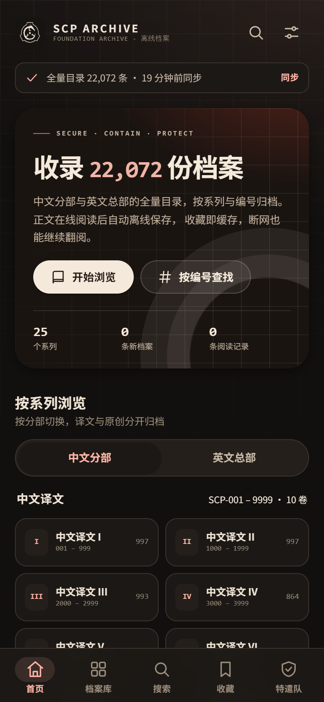
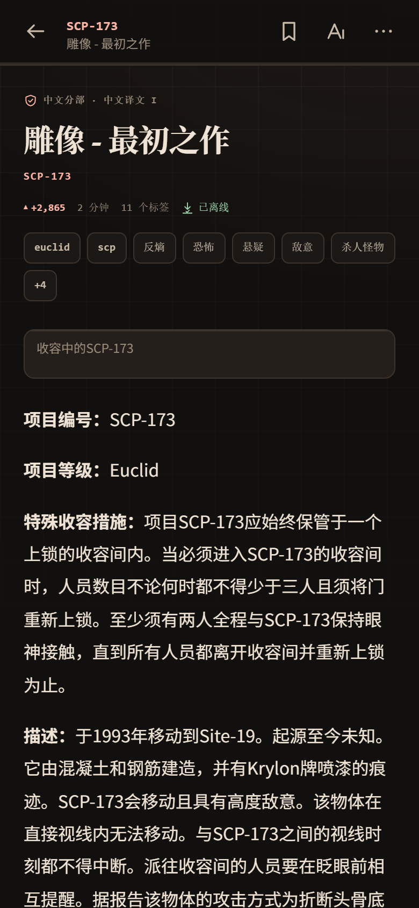
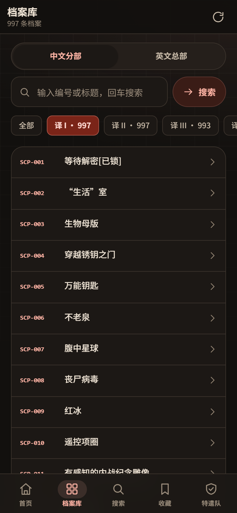
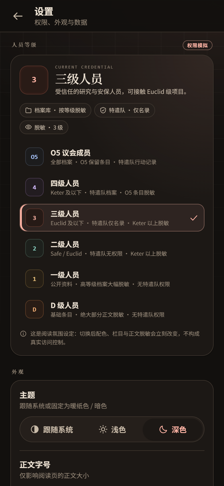
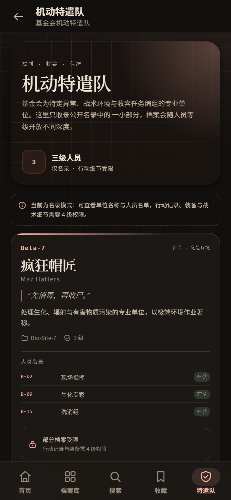
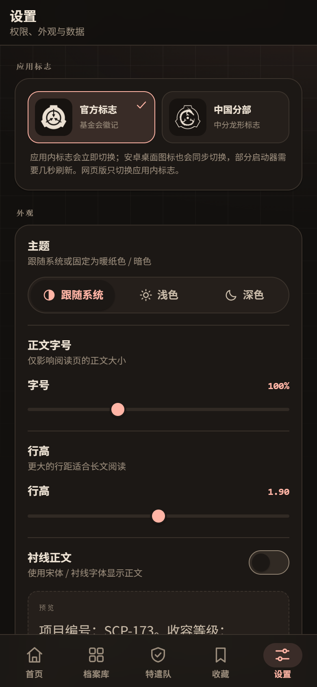
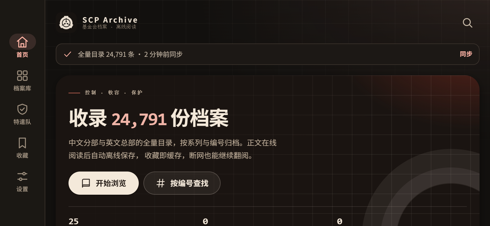

# SCP Archive

> 一个 Material 3、离线优先的 SCP 基金会档案阅读器。

📁 **第一次打开仓库，不知道每个目录是做什么的？请看 [中文目录导航](目录说明.md)。**

每个顶层目录和 `src/` 子目录里都有一份中文 `README.md`；点开目录即可看到该目录的用途、关键文件和修改注意事项。

SCP Archive 是一个非官方的开源阅读器，面向手机屏幕设计。它把中文分部与英文总部的全量目录装进 App，正文按需抓取并自动缓存，断网时也能继续读已经打开过的档案。

<p align="center">
  
  
</p>
<p align="center">
  
  
</p>
<p align="center">
  
  
</p>
<p align="center">
  
</p>

## 下载

v0.4.0 同时提供两个独立安装包，功能完全相同，只是桌面图标不同；两个包的 applicationId 不同，可以并排安装，数据互不相通。

- **官方 SCP 标志版**：[scp-archive-official.apk](https://github.com/ZerooTTwo/scp-archive/releases/latest/download/scp-archive-official.apk)
- **SCP 中国分部标志版**：[scp-archive-cn.apk](https://github.com/ZerooTTwo/scp-archive/releases/latest/download/scp-archive-cn.apk)
- **Web / PWA**：`npm run build` 后部署 `dist/`，或本地 `npm run dev`

<p align="center">
  
  &nbsp;&nbsp;&nbsp;&nbsp;
  
</p>
<p align="center">
  <sub>官方标志版 / 中国分部标志版</sub>
</p>

两个 APK 都使用 release keystore 签名。安装时仍需允许未知来源；从旧 debug 版或另一个图标版覆盖安装会因签名/包名不同而失败，需要先卸载旧版（会清空本地收藏与进度）。

## 功能

- **全量目录**：内置 25 个系列页的快照，共 22,072 条档案（中文 12,220 条 + 英文 9,852 条），按系列与编号归档。
- **中文译本 + 原创**：中文分部同时收录 SCP-001 – 9999 的中文译文与 SCP-CN-001 – 4999 的中文原创，译文和原创分卷浏览，不再只显示英文原文。
- **浏览与检索**：分部切换、系列筛选、编号/标题搜索、只看新增、随机档案；系列内滚动到列表底部才加载下一批，不再一次性渲染整卷。
- **离线阅读**：打开过的正文自动写入本地；收藏时主动下载正文；最多保留 300 篇正文。
- **收藏与进度**：收藏、阅读历史、段落进度全部保存在本机，不上传服务器。
- **阅读体验**：目录（TOC）、字号/行高/衬线调节、浅色/深色/跟随系统、可折叠段落、表格横向滚动、图片与脚注；正文外链交给系统浏览器打开。
- **自动同步**：启动或回到前台时，如果距上次同步超过 12 小时，会静默检查 25 个系列页；新条目会在列表中标记为 `新`。
- **人员等级**：设置页最上方可在 O5、4、3、2、1、D 级六档之间切换；全站主色、深色档案头、底栏栏目与正文脱敏程度会随之变化。
- **机动特遣队**：O5 / 4 级可查看完整行动记录、装备与人员状态；3 级只能查看单位名录；1 级与 D 级无访问权限，底栏入口也会隐藏。
- **PWA + Android**：浏览器里可作为 PWA 安装；Android 端使用 Capacitor 打包，可直接安装 APK；横屏时底栏变为左侧导航栏。
- **图标可选**：设置页可在官方 SCP 标志与中国分部中分标志之间切换应用内标志；安装包本身分为官方版与中分版。
- **中文界面**：应用壳、权限、特遣队与常用标签均已中文化；英文原文条目会提示是否有中文译本，并提供原文/中文版入口。
- **自定义翻译接口**：可填写任意 OpenAI 兼容的 `/chat/completions` 接口（DeepSeek、OpenAI、本地 Ollama 等），按篇翻译当前英文档案；译文缓存在本机，并明确标注“机器翻译”。API Key 只保存在本地 IndexedDB，不会上传到本项目服务器。
- **分享**：调用系统分享面板分享档案链接，失败时回退到复制链接。

## 数据与离线策略

| 内容 | 是否内置 | 说明 |
| --- | --- | --- |
| 目录（编号 + 标题 + 系列） | 是 | `public/seed/catalog.json`，约 3.2 MB |
| 正文 | 否 | 首次阅读时抓取，随后写入 IndexedDB |
| 图片 | 否 | 在线阅读时加载；不保证离线可用 |
| 收藏 / 历史 / 设置 | 本地 | IndexedDB + localStorage 主题镜像 |
| 机器翻译 | 本地缓存 | 调用用户自备的翻译 API，按篇缓存，不上传本项目服务器 |

“包含全部 SCP”指的是**目录全量**，而不是把一万多篇正文一起塞进安装包。这样安装包可以保持在较小体积，同时仍然能离线打开读过的内容。

## 技术栈

- React 19 + TypeScript 5.9
- Vite 7 + `vite-plugin-pwa`
- React Router 7（HashRouter）
- Capacitor 8（Android）
- IndexedDB（`idb-keyval`）
- 手写 Material 3 设计系统，无 UI 组件库

## 本地开发

需要 Node.js 22+。

```bash
npm install
npm run dev
```

打开 `http://localhost:5173`。开发态由 Vite 代理 `/wiki/cn` 与 `/wiki/en`，以绕过浏览器 CORS；Android 端由 `CapacitorHttp` 直接请求 Wiki。

其他命令：

```bash
npm run typecheck   # 只做类型检查
npm run build       # 类型检查 + 生产构建，输出 dist/
npm run preview     # 预览生产构建（PWA 在 localhost 下可用）
```

## 构建 Android APK

### 使用 GitHub Actions（推荐，无需本地 Android SDK）

仓库包含 `.github/workflows/android.yml`。推送代码或手动触发 workflow 后，CI 会：

1. 安装 Node 22 与 JDK 21；
2. `npm ci`、`npm run build`；
3. `npx cap sync android`；
4. 从 Actions Secrets 解码 release keystore，执行 `./gradlew assembleOfficialRelease assembleCnRelease`；
5. 校验两个 APK 的签名，并上传 `scp-archive-official.apk`、`scp-archive-cn.apk` 作为 Actions artifact。

推送 `v*` 标签时，两个已签名 APK 都会附加到对应的 GitHub Release。

签名使用仓库 Secrets（不要提交 keystore）：

| Secret | 内容 |
| --- | --- |
| `ANDROID_KEYSTORE_BASE64` | release keystore 的 Base64 |
| `ANDROID_KEYSTORE_PASSWORD` | keystore 密码 |
| `ANDROID_KEY_ALIAS` | key alias |
| `ANDROID_KEY_PASSWORD` | key 密码 |

本地生成 keystore（示例，密码请自行保管）：

```bash
keytool -genkeypair -v -keystore ../scp-archive-release.jks \
  -storetype PKCS12 -alias scp-archive -keyalg RSA -keysize 4096 \
  -validity 10000 -dname "CN=SCP Archive, O=SCP Archive, C=CN"
base64 -w0 ../scp-archive-release.jks > ../keystore.b64
```


### 本地构建

需要 JDK 21、Android SDK 与 Android Studio。Android 工程已经提交在 `android/`，不需要重新 `cap add`。

```bash
npm run cap:sync
cd android
./gradlew assembleOfficialRelease assembleCnRelease
```

产物位于：

- `android/app/build/outputs/apk/official/release/app-official-release.apk`
- `android/app/build/outputs/apk/cn/release/app-cn-release.apk`

本地未设置 `SCP_KEYSTORE_PATH` 等环境变量时，release 产物不会签名；请使用上面的 Secrets 配置，或自行导出四个环境变量。

## 更新目录快照

目录脚本会依次抓取 25 个 Wikidot 系列页，解析其中的条目链接并去重：

```bash
npm run seed
```

输出 `public/seed/catalog.json`。脚本带有并发限制与请求间隔，请勿高频运行，以免给 Wiki 造成压力。若 Wiki 的页面结构变化，需要同步调整 `scripts/build-seed.mjs` 的解析规则。

## 项目结构

```text
src/
  components/       通用 UI（按钮、Sheet、Dialog、图标、条目行、底栏）
  data/             机动特遣队名录
  pages/            首页、档案库、搜索、收藏、阅读器、设置、特遣队
  lib/              Wiki 抓取/解析、清洗、IndexedDB、同步、权限与脱敏、格式化
  state/            设置、Toast、目录、收藏/历史/离线状态
  styles/           Material 3 token、基础样式、组件、页面、阅读器排版
public/
  seed/catalog.json 目录快照
  icons/            PWA / Android 图标
scripts/
  build-seed.mjs    抓取并生成目录
  make-icons.py     生成两套图标与启动图
android/            Capacitor Android 工程
```

## 已知限制

- 正文来自 Wikidot，页面结构或访问策略变化可能导致抓取失败；失败时会保留本地缓存。
- 图片不保证离线；正文内图片仍需要网络。
- 只覆盖中文分部 001–4999 与英文总部 001–9999 的系列页；未收录的分部/页面不会出现在目录中。
- 没有账号系统，收藏与进度不会跨设备同步。
- 人员等级只是阅读氛围与界面模拟，不构成真实访问控制；它不会改变 Wiki 上的公开内容。
- CI 产出 release 签名的 APK；debug 构建仍可用 `./gradlew assembleDebug`。
- 英文原文条目只有在中文分部存在对应译文时才能切换中文；没有译文的条目会显示提示与原文入口。
- 机器翻译需要用户自己的 API Key；翻译质量、费用、限流由所选服务商决定。默认不会自动翻译整站，也不会把 Key 上传到本项目服务器。当前只翻译正文与标题，标签使用内置词典，未覆盖的标签保留英文。
- 两个图标版 APK 使用不同 applicationId，本地数据不共享；未来如需共享数据需要额外的迁移方案。

## 许可与声明

- **代码**：MIT，见 [LICENSE](LICENSE)。
- **SCP Wiki 内容**：来自 [SCP Foundation Wiki](https://scp-wiki.wikidot.com/) 与 [SCP 中文分部](https://scp-wiki-cn.wikidot.com/)，除另有注明外遵循 [CC BY-SA 3.0](https://creativecommons.org/licenses/by-sa/3.0/)。
- **图标**：官方 SCP 标志来自 [SCP-Art-Repo](https://github.com/mofosyne/SCP-Art-Repo) 的 `Logo/v3.6/SCP_Logo-black-badge.png`；中国分部“中分标志”来自 [SCP 中文分部图形模板](https://o5command-int.wdfiles.com/local--files/tech-team:graphic-templates/scp-logo-cn-400.png)。两者均按 CC BY-SA 3.0 使用，版权归 SCP 基金会 / SCP 中文分部及原作者所有。
- 本项目是非官方粉丝项目，与 SCP 基金会无隶属关系。SCP 名称及相关内容归各自作者所有。

如果喜欢这个项目，欢迎提交 Issue 或 PR；请不要把 Wiki 正文重新打包进本仓库。
